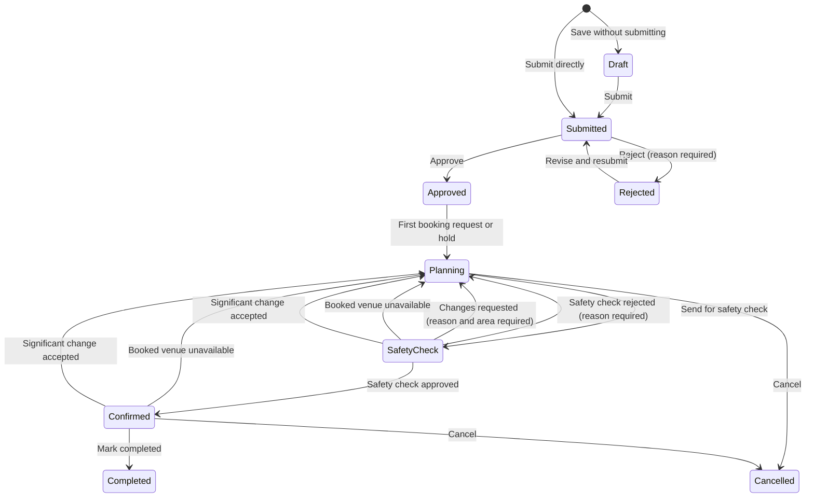
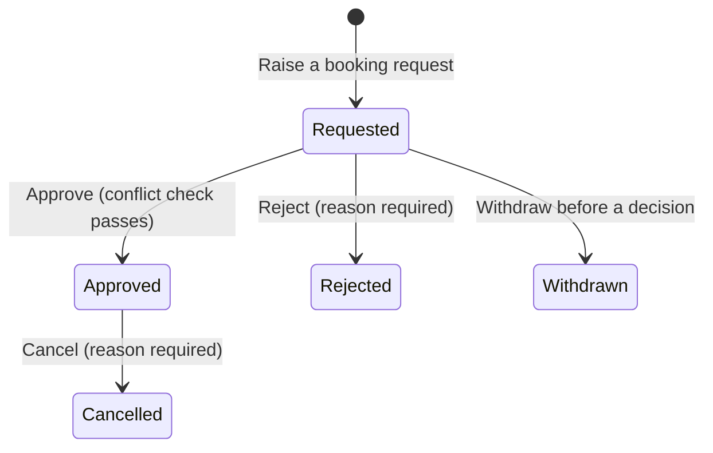
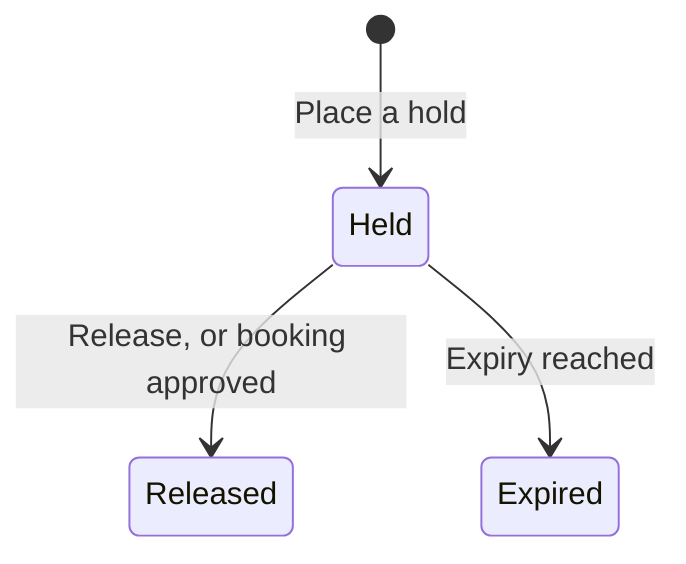
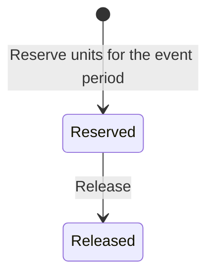
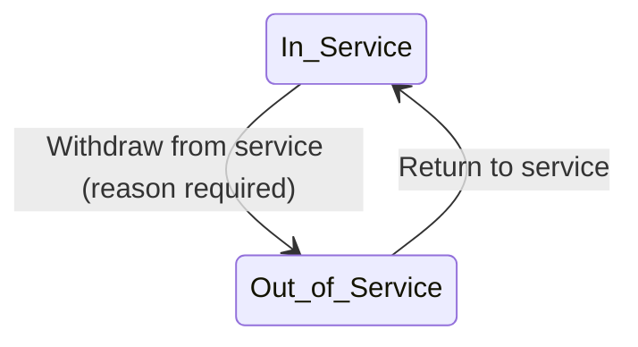
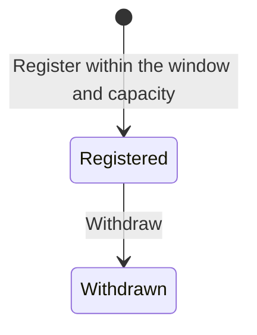
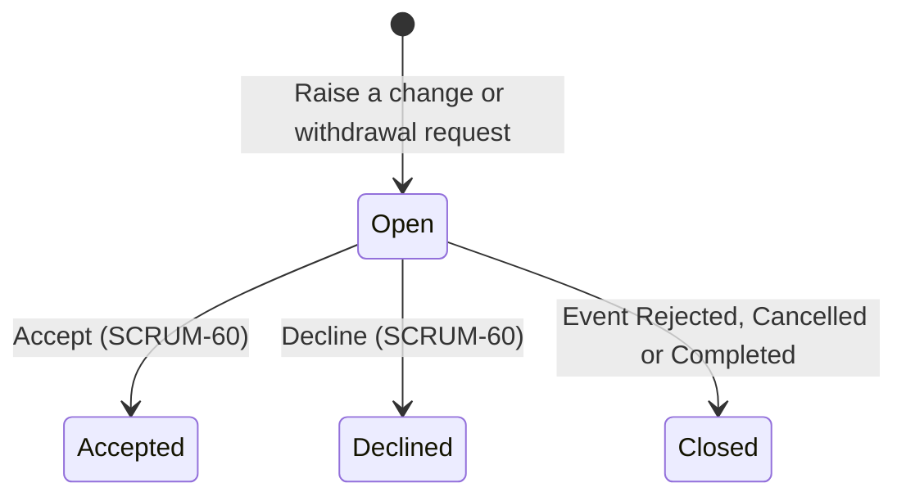

# State model

Every acceptance criterion that changes a status uses a value from these tables. Adding a status or transition means changing this file first, in the same pull request as the story that needs it.

| Version | Date | Change | Reason |
|---|---|---|---|
| 1.0 | 10-09-2026 | Initial model | Pre-sprint preparation |
| 1.1 | 15-09-2026 | Event request: removed Under Clarification (clarification is a flag on Submitted); added Rejected → Submitted; added Confirmed → Planning; Approved → Planning is by system assignment; Confirm requires every recorded arrangement approved; Cancelled is terminal | Customer clarifications Q-01, Q-11 (decision log); team decisions D-13, D-14, D-15, D-16 |
| 1.2 | 16-09-2026 | No change to any status or transition; recorded that the front end mirrors these words | `ui-guidelines.md` v1.1 §9 stops pages typing status strings by hand |
| 1.3 | 08-10-2026 | Venue booking request: dropped the unenforced "(conflict check passes)" qualifier on Approve, with a footnote explaining why | SCRUM-37 review: the qualifier predates any story that defines what a conflict is; approving now matches what the criteria actually say |
| 1.4 | 09-10-2026 | Venue booking request: restored "(conflict check passes)" on Approve, defined the conflict and removed the 1.3 footnote | SCRUM-38 is the story that defines a conflict and enforces it |
| 1.5 | 09-10-2026 | Venue booking request: the conflict is defined on occupied periods — a booking's period widened by the venue's setup and turnaround time — while a block keeps its own period | SCRUM-41 reserves setup and turnaround time around a booking, so two bookings conflict when their occupied periods overlap, and the decision records that blocks themselves are never widened |
| 1.6 | 09-10-2026 | Venue booking request: an extreme recorded duration clamps its occupied period at the edge of Python's date range instead of raising, and no maximum duration is invented | SCRUM-41 review: an accepted setup time of 2000000000 minutes made every read of the venue's bookings fail; reads must keep answering |
| 1.7 | 11-10-2026 | New: Notification, with read as a flag, not a status | SCRUM-58: a notification is created once and never changes status; whether it has been read is a flag on the row, the same pattern as "clarification requested" on an event request |
| 1.8 | 12-10-2026 | Equipment reservation: no status change; recorded that a reservation always belongs to an event and its period is a snapshot of that event's period, complete and valid; defined the committed-peak rule (Reserved only, half-open periods, one window-parameterized calculation shared by SCRUM-49/50/51) | SCRUM-49 AC4 needs an agreed definition of "maximum simultaneously committed units" so the stock guard, the availability check and the reserve check can never become three competing formulas (was 1.7 on the branch; renumbered after SCRUM-58's 1.7 merged first) |
| 1.9 | 13-10-2026 | Event request: new status Safety Check, between Planning and Confirmed; Safety Check → Confirmed (approve) and Safety Check → Planning (reject, reason required) by the Safety Officer. Planning → Safety Check is SCRUM-53's; until it is merged, events enter Safety Check only through the seed data. SCRUM-53 also removes Planning → Confirmed | Week 7 customer change 6; SCRUM-89 (copied from `target/state-model.md` v1.3, this story's slice) |
| 1.10 | 14-10-2026 | Event request: Safety Check → Planning also by Request changes (reason and at least one area required); the Safety changes requested flag on Planning, cleared when the event is sent again | Week 7 customer change 6; SCRUM-90 (copied from `target/state-model.md` v1.3, this story's slice) |
| 1.11 | 14-10-2026 | Event request: Planning → Safety Check is built (sent by the assigned Event Coordinator when every recorded arrangement is approved); Planning → Confirmed (Confirm) is removed, so an event becomes Confirmed only when the Safety Officer approves it | Week 7 customer change 6; SCRUM-53 (copied from `target/state-model.md` v1.3, this story's slice) |
| 1.12 | 15-10-2026 | Event request: Approved → Planning when the first hold is placed for the event (the booking-request half is SCRUM-86's). Venue booking request: another event's Held hold is a conflict on Approve. New: Venue hold (Held, Released; Expired is SCRUM-85's) | Week 7 customer change 4; SCRUM-84 (copied from `target/state-model.md` v1.3, this story's slice) |
| 1.13 | 14-10-2026 | Equipment reservation: no status change; the committed peak may leave one event's reservations out; SCRUM-50 reports the peak as the units reserved for the period | SCRUM-50 AC3, AC4 and AC6 |
| 1.14 | 15-10-2026 | Venue booking request: Approved → Cancelled (reason required; event Approved or Planning) by the event's assigned Event Coordinator; a Cancelled booking never conflicts; an event's booking requests each keep their own status | Week 7 customer change 3; SCRUM-83 (copied from `target/state-model.md` v1.3, this story's slice; the Venue unavailable flag is SCRUM-82's) |
| 1.15 | 16-10-2026 | Event request: Safety Check / Confirmed → Planning when an approved venue booking is marked Venue unavailable (System). Venue booking request: the Venue unavailable flag on Approved | Week 7 customer change 2; SCRUM-82 (copied from `target/state-model.md` v1.3, this story's slice) |
| 1.17 | 18-10-2026 | Equipment review/correction and arrangement notes; review metadata; schema 22 | SCRUM-81 AC1–7 |
| 1.16 | 16-10-2026 | Equipment requirements: Requested creation/correction/removal, unique per event/type, scoped reads; existing safety checks use stored review states | SCRUM-48; review decisions remain SCRUM-81 |
| 1.18 | 19-10-2026 | Venue hold: Held → Expired when its expiry date and time is reached (System); an Expired hold holds nothing and offers no Release | SCRUM-85 (copied from `target/state-model.md` v1.3, this story's slice) |
| 1.19 | 19-10-2026 | Full-quantity equipment reserve/release workflow, current availability and scoped history; no schema or status change | SCRUM-51 AC1–7 |
| 1.20 | 19-10-2026 | Event request: assignment moves to submission (an unassigned queue the Event Coordinator Lead assigns from; not a status); Approved → Planning when the first booking request or hold is raised, replacing auto-assignment at approval; a rejected request keeps its coordinator when resubmitted | Week 7 customer change 5; SCRUM-86 (copied from `target/state-model.md` v1.3, this story's slice; the hold half was SCRUM-84's) |
| 1.21 | — | Manual end-gated completion, UTC completion metadata and conditional write; schema 25 | SCRUM-66; unmerged implementation, date to be recorded at review |
| 1.22 | — | Atomic whole-event cancellation, preserved history and cancellation metadata; schema 26 | SCRUM-65; date pending team review |
| 1.23 | 23-10-2026 | Event request: the clarification requested flag clears also when the request is approved or rejected, and is shown while a clarification is open; the clarifications and replies are kept with the request (a Clarification record: message, replier, times; an open one has no reply and no end) | SCRUM-45 (this story's slice of `target/state-model.md` v1.3, which already has the flag; the target says it clears only when the Organiser responds) |
| 1.24 | 25-10-2026 | No change to any status or transition. Event request: the assigned Event Coordinator edits it after submission; an edit never changes its status or its arrangements, and each significant change is kept in a change record (an EventChange record: field, old and new value, who, when); schema 28 | SCRUM-47 |
| 1.25 | 27-10-2026 | No change to any status or transition. Two flags, not statuses, derived at every read and never stored: **too small** on a Requested or Approved venue booking request and a Held hold, and **timing mismatch** on a Requested or Approved venue booking request and a Reserved equipment reservation | SCRUM-61 |
| 1.26 | 28-10-2026 | No change to any status or transition. Registration: Registered → Withdrawn is built (the Attendee withdraws their own registration until the event starts; never for a Cancelled event); a Withdrawn registration never goes back, so registering again makes a new row | SCRUM-55 AC1 to AC4 |
| 1.27 | 30-10-2026 | No change to any status or transition. Registration: an event's registration has an on/off switch, a capacity and a closing time, set by its assigned Event Coordinator while it is Approved, Planning, Safety Check or Confirmed; "within the window and capacity" means at or before the closing time and while the Registered count is below the capacity. A SCRUM-47 edit that moves the start before the closing time moves the closing time to the new start; schema 30 | SCRUM-92 AC1 to AC5 (the Registration table copied from `target/state-model.md`, which has no wording for the settings themselves) |
| 1.28 | 31-10-2026 | No change to any status or transition. Equipment unit is built: In Service → Out of Service (withdraw, reason required) and Out of Service → In Service (return) by Technical Support Staff. Units are counted per type, not tracked one by one: a type keeps its units out of service, and in service is its total less those; every withdrawal and return is kept (an EquipmentServiceChange record: action, quantity, reason, who, when in UTC). Out-of-service units are not available to the availability check or to reserving, and a total cannot go below them plus the reserved peak from now on | SCRUM-52 (table copied from `target/state-model.md` earlier; this story builds it); schema 31 |
| 1.29 | 31-10-2026 | No change to any status or transition. Registration: — → Registered is built (the Attendee registers for a Confirmed event with registration on, before its closing time and while the Registered count is below the capacity; one Registered registration per Attendee per event; checked under the event's write lock). "Within the window" is before the closing time: from the closing time registration is closed, correcting v1.27's "at or before". A Withdrawn registration never counts and never blocks, so registering again makes a new row | SCRUM-54 AC1 to AC3, AC6 (the Registration table as in `target/state-model.md`) |
| 1.30 | 31-10-2026 | New: Change request (Open; Accepted and Declined are SCRUM-60's; Closed when the event becomes Rejected, Cancelled or Completed), what a change affects and what then needs reviewing; raising a request never changes the event's status | Week 7 customer change; SCRUM-59 (the take note's slice) |
| 1.31 | 01-11-2026 | Change request: Open → Accepted (accept) and Open → Declined (decline, reason required) by the assigned Event Coordinator, with who and when; an accepted change may correct what needs reviewing first; accepting a withdrawal cancels the event (Cancelled, as SCRUM-65); accepting a change that needs venue bookings or equipment reservations reviewed returns a Safety Check or Confirmed event to Planning (Safety Check → Planning is added beside the Confirmed row) | SCRUM-60 AC1 to AC7 (the take note's slice) |

The front end holds these words in `frontend/src/app/format.js` (`STATUS`); a change here changes that file in the same pull request. v1.12 adds Held and Released (`STATUS.HOLD`); v1.18 adds Expired (`STATUS.HOLD.EXPIRED`); v1.14 adds Cancelled to a venue booking request's words (`STATUS.BOOKING.CANCELLED`); v1.15's Venue unavailable is a flag, held there as `VENUE_UNAVAILABLE`.

## Event request

| From | To | Action | Who |
|---|---|---|---|
| — | Draft | Save a new request without submitting | Event Organiser |
| Draft | Submitted | Submit | Event Organiser |
| — | Submitted | Submit a new request directly | Event Organiser |
| Submitted | Approved | Approve | Event Coordinator |
| Submitted | Rejected | Reject (reason required) | Event Coordinator |
| Rejected | Submitted | Revise and resubmit (keeps its assigned coordinator) | Event Organiser |
| Approved | Planning | First venue booking request or hold raised for the event | System, on the assigned coordinator's action |
| Planning | Safety Check | Send for safety check (every recorded arrangement approved) | Assigned Event Coordinator |
| Safety Check | Confirmed | Approve the safety check | Safety Officer |
| Safety Check | Planning | Reject the safety check (reason required) | Safety Officer |
| Safety Check | Planning | Request changes (reason and at least one area required) | Safety Officer |
| Safety Check / Confirmed | Planning | An approved venue booking is marked Venue unavailable | System |
| Safety Check / Confirmed | Planning | Change request accepted when it needs venue bookings or equipment reservations reviewed (SCRUM-60) | Assigned Event Coordinator |
| Confirmed | Completed | Manually mark completed at or after scheduled end | Assigned Event Coordinator |
| Submitted / Approved / Planning / Safety Check / Confirmed | Cancelled | Cancel with a nonblank reason; release event commitments | Assigned Event Coordinator |

Assignment is not a status. A Submitted request with no assigned coordinator is in the **unassigned queue**; the Event Coordinator Lead assigns it, and the status stays Submitted (SCRUM-86). A request resubmitted after rejection keeps the coordinator it had and does not return to the queue. Approving a request assigns no one. Reassignment never changes the status (SCRUM-44).

Flags on a Submitted request, not statuses: **clarification requested** (set by the assigned Event Coordinator, cleared when the Event Organiser replies, or when the coordinator approves or rejects the request, SCRUM-45). The flag is not stored: it is shown while a clarification has no reply and has not been ended by a decision. Only one is open at a time, and every clarification and reply is kept with the request. Cancelled has no outgoing transition; a new request is submitted instead.

Flags, not statuses (continued): **safety changes requested**, on Planning: set by the Safety Officer's request for changes with its reason and areas (venue arrangements, technical arrangements, or both), and cleared when the event is sent for safety check again (SCRUM-90). It is not stored: it is the latest decision, while that decision is a request for changes and the event has not been sent since it.

Each decision the Safety Officer makes is kept with the event: the decision, its reason where one is required, the areas where changes were requested, an optional note per area, the date and the Safety Officer. An event that returns to Safety Check keeps every earlier decision (SCRUM-89).

## Venue booking request

| From | To | Action | Who |
|---|---|---|---|
| — | Requested | Raise a booking request | Event Coordinator |
| Requested | Approved | Approve (conflict check passes) | Venue Staff |
| Requested | Rejected | Reject (reason required) | Venue Staff |
| Requested | Withdrawn | Withdraw before a decision | Event Coordinator |
| Approved | Cancelled | Cancel (reason required; event Approved or Planning) | Assigned Event Coordinator |

An event may have several booking requests, each with its own status; a transition on one never changes another, nor the event's status (SCRUM-83). SCRUM-82's Venue unavailable flag is not a transition of the booking: it is the one case where something done to a venue moves the event (below). Cancelling keeps the approval on record beside the cancellation (its reason, who and when); a hold Released when the booking was approved stays Released.

A conflict (SCRUM-38, widened by SCRUM-41) is an Approved booking or a block of the same venue whose occupied period overlaps the booking's occupied period; SCRUM-84 adds another event's Held hold, compared by the period it covers (below). The event's own hold is never a conflict for its own booking. A booking's occupied period is its own period widened by the venue's setup and turnaround time (SCRUM-41 AC1); a block keeps its own recorded period and is never widened. Requested, Rejected, Withdrawn and Cancelled bookings never conflict, periods that only touch at a boundary do not overlap, and a booking never conflicts with itself. A refused approval leaves the booking Requested. Rejecting is never checked.

Flag on Approved, not a status: **Venue unavailable** (SCRUM-82). An Approved booking carries it while any block of its venue overlaps the booking's occupied period; touching does not count, and no other status carries it. It is derived at every read and never stored (occupancy.py, `blocks_over`), so it clears by itself when the booking is cancelled or the block is removed or ended early so that it no longer overlaps, and a change to the venue's setup or turnaround time can set or clear it. Creating the block is the only moment it acts: for each Approved booking the new block overlaps whose event is Approved, Planning, Safety Check or Confirmed, the event's assigned Event Coordinator is notified once (once per block; with no assigned coordinator nobody is told), and an event in Safety Check or Confirmed returns to Planning, nothing else on it changing. A Completed or Cancelled event is left alone. Removing or ending the block never moves the event back, and a duration change that sets the flag notifies nobody and moves nothing. A booking carrying the flag stops the event being sent for safety check (SCRUM-53).

A recorded duration carries no maximum, so an extreme setup or turnaround time can push an occupied period past the first or last date Python represents. The period then clamps to that edge instead of raising: it stays as wide as the duration asks for, and every read that derives it — the booking list, search, warnings, the clash list and the conflict check — still answers. No maximum duration is invented (occupancy.py, `_shift`).

## Venue hold

| From | To | Action | Who |
|---|---|---|---|
| — | Held | Place a hold (expiry required, in the future and before the event's start) | Assigned Event Coordinator |
| Held | Released | Release before expiry | Assigned Event Coordinator |
| Held | Released | A booking request for the same venue and event is approved | System |
| Held | Expired | Expiry date and time reached | System |

Only a Held hold makes the venue unavailable. A hold is never a booking and never counts as an approved arrangement (SCRUM-84, SCRUM-85). The period a hold covers is its event's own period widened by the venue's setup and turnaround time, derived at every read like a booking's occupied period and never stored, so changing either duration moves it. Both expiry limits are strict: the expiry must be after now (`clock.now_local()`) and before the event's published start, not the start of its occupied period. A hold is refused when another event's Approved booking or Held hold, or a block, overlaps that period; periods that only touch do not. An event holds a venue at most once at a time (PO decision at curation); a Released or Expired hold does not count, so the venue may be held again.

A hold stops holding when the current time (`clock.now_local()`) reaches its expiry: equal counts, one minute before it still holds (SCRUM-85). There is no scheduler: at the start of every API request the system saves a Held hold whose expiry has been reached as Expired and tells the event's assigned Event Coordinator it expired and the venue was released; a Held hold with 24 hours or less left gets one warning, recorded on the hold so it is never sent twice, and none once it has expired. Whether a hold holds also compares its expiry with the time, so it stops at exactly its expiry even before the next request saves it. Expiry never changes the event's status; with no assigned coordinator the hold still expires and nobody is told. An Expired hold offers no Release (SCRUM-85, PO decisions).

## Equipment reservation

| From | To | Action | Who |
|---|---|---|---|
| — | Reserved | Reserve the full Approved requirement for the event period; event Approved or Planning, sufficient availability, no unreleased reservation | Technical Support Staff |
| Reserved | Released | Release while the event is Approved or Planning | Technical Support Staff |

A reservation always belongs to an event: the link is required, and it survives release. Its period (date, start time, end time) is a **snapshot** of the event's period taken when the reservation is made — the same convention as a venue booking request, which is copied from its event at the moment of raising and is not moved by a later change to the event (models.VenueBookingRequest). Every reservation therefore carries a complete, valid period: a real date, `HH:MM` times, start strictly before end. Event date and times cannot change once an event leaves Draft under today's rules, so a snapshot cannot drift now; **the future story that first makes event timing mutable after a reservation exists owns deciding whether linked reservation periods move with it.** That reconciliation is not part of SCRUM-49.

**What commits stock.** Only a reservation in `Reserved` commits units; `Released` never does, and a past reservation period never does. A requirement that has not become a reservation commits nothing.

**Leaving an event out (SCRUM-50).** The committed peak can leave one event's reservations out, so a check made for an event's own requirement does not count what that event already holds (SCRUM-50 AC6).

**The committed peak (one calculation, three consumers).** For a type and a half-open time window `[window_start, window_end)` — `window_end` omitted meaning unbounded future — the committed peak is the maximum number of units of that type simultaneously held by `Reserved` reservations whose own half-open periods `[start, end)` overlap the window. Periods that only touch at a boundary do not overlap, and where a period ends exactly where another begins the ending is applied first (the same boundary rule as venue occupancy). SCRUM-49's stock-reduction guard asks for the peak over `[now, ∞)`: a total may not fall below it. SCRUM-50's availability check asks for the peak inside a proposed event's period, and SCRUM-51 must ask the same period-scoped question when reserving — neither may count commitments outside their window. `now` is `clock.now_local()`. One function answers all three; there is no second formula.

## Equipment unit

| From | To | Action | Who |
|---|---|---|---|
| In Service | Out of Service | Withdraw from service (reason required) | Technical Support Staff |
| Out of Service | In Service | Return to service | Technical Support Staff |

## Registration

| From | To | Action | Who |
|---|---|---|---|
| — | Registered | Register within the window and capacity | Attendee |
| Registered | Withdrawn | Withdraw | Attendee |

**The window and capacity (SCRUM-92).** They are settings on the event, not
statuses: registration on or off, a capacity, and a closing date and time. The
event's assigned Event Coordinator sets them while the event is Approved,
Planning, Safety Check or Confirmed. The capacity is a whole number of at
least 1 and never below the number of Registered registrations (Withdrawn ones
never count); the closing time has a date and a time, is never after the
event's start (exactly at the start is allowed) and is kept as local
wall-clock time, like the event's own date and times. Turning registration on
with none stored takes the expected attendance and the event's start;
registration cannot be turned off while anyone is Registered, and turning it
off keeps both values. A SCRUM-47 edit that moves the event's start before the
closing time moves the closing time to the new start, in the same save,
without a change-record line.

**Registering (SCRUM-54).** An Attendee registers for an event that is
Confirmed with registration on, before its closing time (from the closing time
it is closed) and while the Registered count is below the capacity, so the
last place can be taken and no more. An Attendee holds at most one Registered
registration per event; a Withdrawn one never counts and never blocks, and
registering again makes a new row. Every check is read under the event's
write lock, the one SCRUM-92 saves the settings under, so places go first come,
first served. A refusal changes nothing. An event an Attendee could never have
seen listed (before Confirmed, or Rejected) is answered as not found.

## Change request

A change request (SCRUM-59) is the Event Organiser's request, after submitting, for a change to their event or for its withdrawal. It belongs to one event, which keeps its own status: raising, deciding or closing a request never changes the event's status (accepting one may return the event to Planning, or cancel it, as the rows below say).

| From | To | Action | Who |
|---|---|---|---|
| — | Open | Raise a change request (a description and what it affects) or a withdrawal request (optional text) while the event is Submitted, Approved, Planning, Safety Check or Confirmed | Event Organiser (own event) |
| Open | Accepted | Accept, optionally correcting what needs reviewing first (SCRUM-60). Accepting a withdrawal cancels the event with the reason "Withdrawn at the Event Organiser's request on <date and time>." followed by the Organiser's text if any; accepting a change that needs venue bookings or equipment reservations reviewed returns a Safety Check or Confirmed event to Planning; otherwise the event's status is unchanged and it is never edited | Assigned Event Coordinator |
| Open | Declined | Decline, reason required (SCRUM-60); the event is unchanged | Assigned Event Coordinator |
| Open | Closed | The event becomes Rejected, Cancelled or Completed; closed without a decision | System |

Only one request is Open on an event at a time. A change affects one or more of date or time, expected attendance, venue requirements and equipment, or other: date or time means the venue bookings and the equipment reservations need reviewing, attendance or venue requirements mean the venue bookings do, equipment means the equipment reservations do, other needs neither. With no coordinator assigned the request waits, and the coordinator is told when assigned (SCRUM-86).

## Notification

A notification has no status and no transition: it is created once, addressed to one account, and never changes afterwards except for one flag.

Flag, not a status: **read** (set when the recipient opens it; cleared never — there is no "mark unread"). The same pattern as "clarification requested" on an event request, above.

## SCRUM-48 — Equipment requirement (implemented)

A detailed requirement belongs to one event and one recognised equipment type;
that pair is unique across all review states. Quantity is a positive whole
number at most 2^53-1; optional technical requirements are text (blank is valid).
New rows are Requested. Only the assigned Event Coordinator may add, correct
quantity/technical text or remove Requested rows, only while Approved or Planning.
Approved/Declined rows are read-only through these actions; review is SCRUM-81.
No stock, reservation or event status changes. Original Organiser free-text
needs are separate. Numeric strings are exact; JSON numbers have the parser's
normal precision (as in SCRUM-49). There is no app-wide JSON-provider change.
Technical Support sees non-Draft event timing, Approved venue bookings and
requirements through a scoped equipment view. Other Coordinators cannot read
another Coordinator's equipment. Safety readiness now lists non-Approved rows,
and the existing Safety Officer view includes only Approved rows.

Schema version 21 adds equipment_requirements. Development reset is destructive:
back up local data before seed.py --reset. No production migration is claimed.

## SCRUM-81 — Equipment requirement review

| From | To | Action | Who |
|---|---|---|---|
| Requested | Approved | Approve | Technical Support Staff |
| Requested | Declined | Decline, nonblank reason required | Technical Support Staff |
| Approved | Declined | Correct decision, nonblank reason required | Technical Support Staff |
| Declined | Approved | Correct decision, clear current decline reason | Technical Support Staff |

All decisions require the event to be Approved or Planning and **no Reserved
reservation for this event and equipment type**, including a partial reservation.
Released reservations do not block, nor do reservations for other events/types.
No clock-based exception: a reservation still marked Reserved remains unreleased.
Each successful decision records the acting account and UTC time. Repeating a
valid decision is accepted and records that successful decision in the same way.
There is no reset-to-Requested action or new decision-history subsystem.

Only Technical Support may add/change the arrangement note, including on Approved
or Declined rows, while the event is Approved or Planning. A Reserved reservation
does not lock notes. Notes do not change the review metadata or decline reason.
Decisions and notes never change requested details, other requirements, event
status, stock or reservations. Approval is not reservation. Coordinator Requested
quantity/text edits and removals remain SCRUM-48 actions with their existing rules.

Schema 22 adds decline_reason, decided_by_id, decided_at and arrangement_note to
equipment_requirements. The read-only has_unreleased_reservation flag is derived,
not stored. Back up local data before the existing destructive development reset:
`python backend/seed.py --reset`. No production migration is claimed. SCRUM-51 must
recheck Approved status and the authoritative event stage in its reserve transaction
and use the same event/type identity; this story adds no reservation endpoint.

## SCRUM-51 — equipment commitments

Only Technical Support Staff reserves/releases, in Approved or Planning. A
reservation takes the Approved requirement's full quantity, type, and event
period snapshot. One Reserved row per event/type (the unique requirement
identity); Released history remains, and a new reservation can be made after
release. Reserve uses the shared SCRUM-50 availability calculation inside the
write transaction, including SCRUM-52's out-of-service provider when built.
Total stock and requirements/review decisions never change. There is no partial
quantity editor and no auto-reservation on review approval. Release removes only
that commitment; it is not physical deletion or an event-stage transition.
Ordinary reserve/release is locked outside Approved/Planning, including Safety
Check and Confirmed. Returning to Planning does not automatically release units.

Write lock order: event, equipment type, requirement (reserve only). No-op updates
obtain real write locks on SQLite before authoritative reads. Event stage, review
state, duplicate commitment and current stock are checked while locked; all
refusals roll back. Released rows remain associated with their event/type even
if an old requirement was removed. No schema change: SCHEMA_VERSION remains 23.

Integration obligations, NOT implemented here: SCRUM-52 currently supplies zero
out-of-service units; its real quantity must feed the shared provider. SCRUM-53
currently requires review approval, not reservations, before Safety Check. Its
owner must agree/update that readiness rule if committed equipment is required;
SCRUM-51 does not silently change safety submission or add a notification flow.

## SCRUM-66 — Manual event completion (schema 25)

Confirmed → Completed is explicit, assigned-Coordinator-only, at or after the
scheduled end date/time in Singapore. Completed has no outgoing lifecycle
transition. Refusals and repeated attempts preserve completion metadata.
`EventRequest.completed_by_id` references the actor; `completed_at` is UTC and
serialised with `Z` in the authorised detail's `completion` object. Metadata is
absent on records not completed by this action. The controlled local clock
supplies both eligibility and the timestamp. An atomic conditional write also
checks assignment, status and the period have not changed since validation.
Completion changes no other event fields, booking, hold, requirement, reservation
or notification. Active lists/counts already exclude Completed; existing object
read permissions continue to apply. This story adds no retrospective reporting,
auto-completion or resource-release workflow.

### SCRUM-66 v2 audit clarification

Completed events are excluded from active-event lists and workload counts, not
from the assigned Coordinator's general Requests/history list. Completion
metadata is returned only when both its actor and timestamp exist; absent or
partial legacy data remains readable and is not backfilled with invented values.

## SCRUM-65 — Event cancellation (schema 26)

Cancelled is terminal: no return to another lifecycle status or further planning.
The assigned Coordinator supplies a nonblank, trimmed reason in one of the five
permitted stages. EventRequest.cancelled_at is UTC, cancelled_by_id identifies
the Coordinator and cancel_reason retains the reason. Detail JSON includes
`cancellation: {cancelled_at (Z), cancelled_by, reason}` only when actor and time
exist; legacy/partial metadata is safely omitted, not invented or backfilled.

The same commit changes every own Requested booking request to Withdrawn,
every own Approved booking to Cancelled (its own cancellation actor/time/reason
are filled, its approval history retained), every own Held hold to Released
(released_at filled) and every own Reserved equipment reservation to Released.
All already terminal arrangements remain unchanged. No record is deleted,
no stock or equipment review is changed, and other events are untouched.
All effects succeed together or roll back together. Resource providers already
exclude these released/cancelled/withdrawn statuses; no availability formula is
duplicated. Other bookings, venue blocks, inactive venues and out-of-service
units can still prevent availability. A venue becoming unavailable alone never
triggers event cancellation (Week 7 change 2).

Lock order is event then affected equipment types in ascending id order, matching
SCRUM-51. Fresh ownership/status under the event write lock prevents a stale or
repeated cancellation; reserve serialises against the same event lock. This
workflow intentionally bypasses standalone per-arrangement stage restrictions
without calling their individually committing service actions. The controlled
Singapore clock supplies one instant converted to UTC for all cancellation
metadata. Cancellation introduces no scheduled-end boundary.

The general Requests list retains permitted historical records; active-event
queries/counts exclude Cancelled already. SCRUM-72 still permits resubmission
only of Rejected requests. A new event after cancellation is a new request,
not restoration of released bookings or reservations. SCRUM-64 owns notices;
SCRUM-59/60 own withdrawal requests and decisions. No notification is added by
this story, including per-arrangement release notices.

SCRUM-65 audit follow-up: venue booking/hold writes now take the same event
write lock before eligibility/ownership checks and expire cached ORM reads.
This covers raising, holding, deciding, withdrawing, cancelling and releasing
a hold through the existing shared helpers. It prevents an in-flight stale
venue write from recommitting arrangements or returning a Cancelled event to
Planning after the cancellation cascade. Existing status/permission messages
and commit boundaries are unchanged; no new lifecycle transition is added.

## SCRUM-47 — Editing an event after submission (schema 28)

The assigned Event Coordinator edits a Submitted, Approved, Planning, Safety
Check or Confirmed event (`PATCH /api/requests/:id`); a Draft is its
Organiser's (SCRUM-30), a Rejected request is revised when it is resubmitted
(SCRUM-72), and a Completed or Cancelled event cannot be edited. The
submission checks apply to what is changed: required fields stay filled, a
changed date is not before today (Singapore, the controlled clock), start is
before end, attendance is a positive whole number. A refusal changes nothing.

A change to the date, start or end time, expected attendance, equipment
requirements, or required layout, facilities or accessibility features is
significant; any other change is ordinary. Significant changes are refused in
Safety Check and Confirmed: an accepted change request that needs venue bookings
or equipment reservations reviewed returns the event to Planning (SCRUM-60), and the
edit is then made in Planning. While the event has a Held hold, its date and
times are refused until the hold is released; Released and Expired holds and
Approved bookings do not stop it.

Each significant change adds one EventChange row (field, old value, new
value, changed_by, changed_at in UTC), shown to the assigned coordinator as
`change_record` on the event's detail. Ordinary changes are not recorded.
The edit never changes the event's status or its flags, and never moves,
cancels or releases a booking request, hold or equipment reservation: each
keeps the date, times and attendance it was made with.

## SCRUM-61 — Flags on arrangements affected by an event change

Two flags, not statuses. Both are derived at every read and never stored
(`backend/arrangement_flags.py`), so each goes by itself when its cause goes,
and neither ever changes a status, cancels, withdraws or releases anything.

**Too small**, on a Requested or Approved venue booking request and on a Held
hold: the event's expected attendance is more than that venue's maximum
capacity. Each venue is compared on its own; attendance equal to the capacity
fits (the SCRUM-42 suitability rule). It follows a change to either number:
the event's attendance (SCRUM-47) or the venue's capacity. Shown to the
assigned Event Coordinator on the event, to Venue Staff on the venue's booking
requests, and to the Safety Officer on the Safety check card.

**Timing mismatch**, on a Requested or Approved venue booking request and on a
Reserved equipment reservation: its date, start time or end time is not the
event's. Bookings and reservations keep the period they were made with
(SCRUM-47), so a change to the event's period flags them, and putting it back
clears the flag. A hold keeps no period of its own: it covers the event's
current one, and SCRUM-47 refuses a change to the date or times while it is
Held, so a hold is never flagged for timing. A reservation's flag is shown to
the assigned Event Coordinator and to Technical Support Staff on the event's
equipment page.
