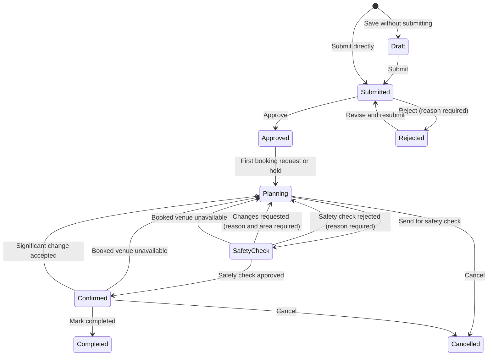
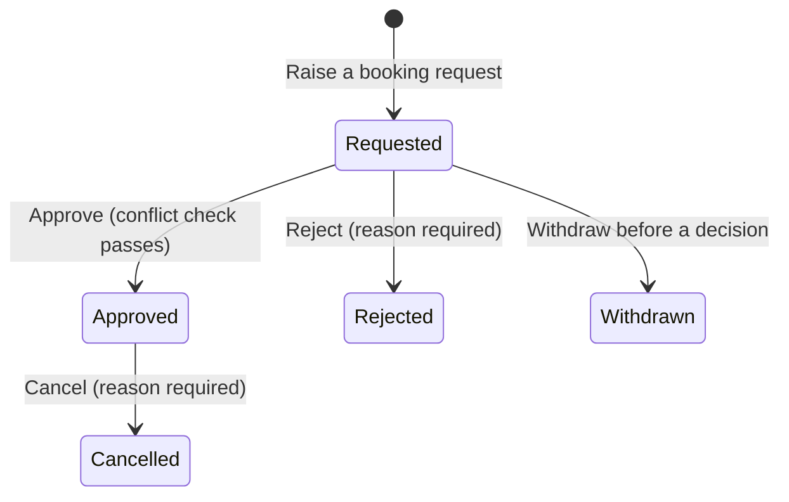
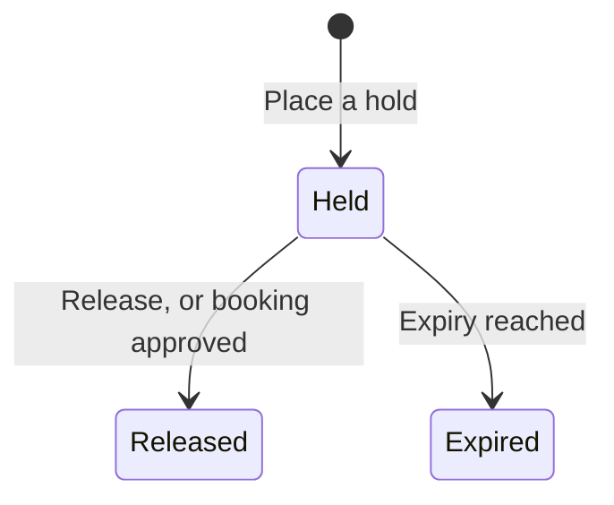
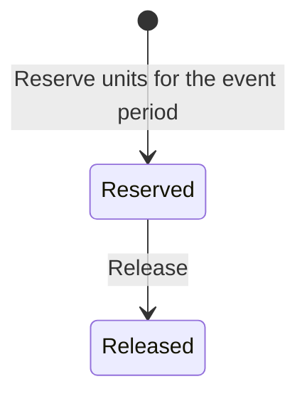
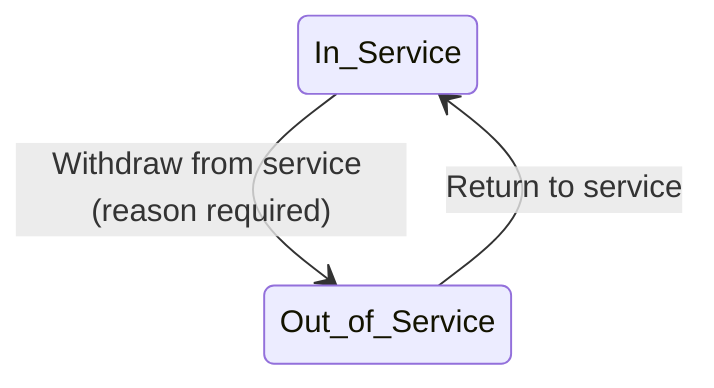
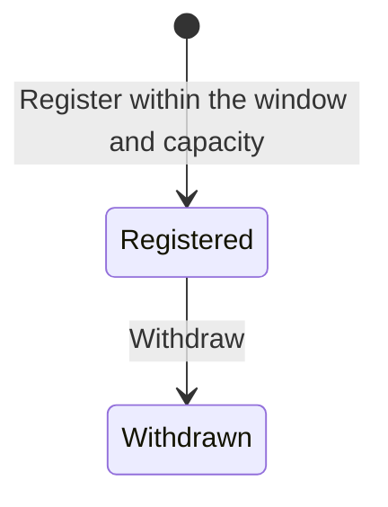

# State model

Every acceptance criterion that changes a status uses a value from these tables. Adding a status or transition means changing this file first, in the same pull request as the story that needs it.

| Version | Date | Change | Reason |
|---|---|---|---|
| 1.0 | 10-09-2026 | Initial model | Pre-sprint preparation |
| 1.1 | 15-09-2026 | Event request: removed Under Clarification (clarification is a flag on Submitted); added Rejected → Submitted; added Confirmed → Planning; Approved → Planning is by system assignment; Confirm requires every recorded arrangement approved; Cancelled is terminal | Customer clarifications Q-01, Q-11 (decision log); team decisions D-13, D-14, D-15, D-16 |
| 1.2 | 16-09-2026 | No change to any status or transition; recorded that the front end mirrors these words | `ui-guidelines.md` v1.1 §9 stops pages typing status strings by hand |
| 1.3 | 08-10-2026 | Venue booking request: dropped the unenforced "(conflict check passes)" qualifier on Approve, with a footnote explaining why | SCRUM-37 review: the qualifier predates any story that defines what a conflict is; approving now matches what the criteria actually say |
| 1.4 | 09-10-2026 | Venue booking request: restored "(conflict check passes)" on Approve, defined the conflict and removed the 1.3 footnote | SCRUM-38 is the story that defines a conflict and enforces it |
| 1.5 | 09-10-2026 | Venue booking request: the conflict is defined on occupied periods — a booking's period widened by the venue's setup and turnaround time — while a block keeps its own period | SCRUM-41 reserves setup and turnaround time around a booking, so two bookings conflict when their occupied periods overlap, and the decision records that blocks themselves are never widened |
| 1.6 | 09-10-2026 | Venue booking request: an extreme recorded duration clamps its occupied period at the edge of Python's date range instead of raising, and no maximum duration is invented | SCRUM-41 review: an accepted setup time of 2000000000 minutes made every read of the venue's bookings fail; reads must keep answering |
| 1.7 | 11-10-2026 | New: Notification, with read as a flag, not a status | SCRUM-58: a notification is created once and never changes status; whether it has been read is a flag on the row, the same pattern as "clarification requested" on an event request |
| 1.8 | 12-10-2026 | Equipment reservation: no status change; recorded that a reservation always belongs to an event and its period is a snapshot of that event's period, complete and valid; defined the committed-peak rule (Reserved only, half-open periods, one window-parameterized calculation shared by SCRUM-49/50/51) | SCRUM-49 AC4 needs an agreed definition of "maximum simultaneously committed units" so the stock guard, the availability check and the reserve check can never become three competing formulas (was 1.7 on the branch; renumbered after SCRUM-58's 1.7 merged first) |
| 1.9 | 13-10-2026 | Event request: new status Safety Check, between Planning and Confirmed; Safety Check → Confirmed (approve) and Safety Check → Planning (reject, reason required) by the Safety Officer. Planning → Safety Check is SCRUM-53's; until it is merged, events enter Safety Check only through the seed data. SCRUM-53 also removes Planning → Confirmed | Week 7 customer change 6; SCRUM-89 (copied from `target/state-model.md` v1.3, this story's slice) |
| 1.10 | 14-10-2026 | Event request: Safety Check → Planning also by Request changes (reason and at least one area required); the Safety changes requested flag on Planning, cleared when the event is sent again | Week 7 customer change 6; SCRUM-90 (copied from `target/state-model.md` v1.3, this story's slice) |
| 1.11 | 14-10-2026 | Event request: Planning → Safety Check is built (sent by the assigned Event Coordinator when every recorded arrangement is approved); Planning → Confirmed (Confirm) is removed, so an event becomes Confirmed only when the Safety Officer approves it | Week 7 customer change 6; SCRUM-53 (copied from `target/state-model.md` v1.3, this story's slice) |
| 1.12 | 15-10-2026 | Event request: Approved → Planning when the first hold is placed for the event (the booking-request half is SCRUM-86's). Venue booking request: another event's Held hold is a conflict on Approve. New: Venue hold (Held, Released; Expired is SCRUM-85's) | Week 7 customer change 4; SCRUM-84 (copied from `target/state-model.md` v1.3, this story's slice) |
| 1.13 | 14-10-2026 | Equipment reservation: no status change; the committed peak may leave one event's reservations out; SCRUM-50 reports the peak as the units reserved for the period | SCRUM-50 AC3, AC4 and AC6 |
| 1.14 | 15-10-2026 | Venue booking request: Approved → Cancelled (reason required; event Approved or Planning) by the event's assigned Event Coordinator; a Cancelled booking never conflicts; an event's booking requests each keep their own status | Week 7 customer change 3; SCRUM-83 (copied from `target/state-model.md` v1.3, this story's slice; the Venue unavailable flag is SCRUM-82's) |
| 1.15 | 16-10-2026 | Event request: Safety Check / Confirmed → Planning when an approved venue booking is marked Venue unavailable (System). Venue booking request: the Venue unavailable flag on Approved | Week 7 customer change 2; SCRUM-82 (copied from `target/state-model.md` v1.3, this story's slice) |
| 1.17 | 18-10-2026 | Equipment review/correction and arrangement notes; review metadata; schema 22 | SCRUM-81 AC1–7 |
| 1.16 | 16-10-2026 | Equipment requirements: Requested creation/correction/removal, unique per event/type, scoped reads; existing safety checks use stored review states | SCRUM-48; review decisions remain SCRUM-81 |
| 1.18 | 19-10-2026 | Venue hold: Held → Expired when its expiry date and time is reached (System); an Expired hold holds nothing and offers no Release | SCRUM-85 (copied from `target/state-model.md` v1.3, this story's slice) |
| 1.19 | 19-10-2026 | Full-quantity equipment reserve/release workflow, current availability and scoped history; no schema or status change | SCRUM-51 AC1–7 |
| 1.20 | 19-10-2026 | Event request: assignment moves to submission (an unassigned queue the Event Coordinator Lead assigns from; not a status); Approved → Planning when the first booking request or hold is raised, replacing auto-assignment at approval; a rejected request keeps its coordinator when resubmitted | Week 7 customer change 5; SCRUM-86 (copied from `target/state-model.md` v1.3, this story's slice; the hold half was SCRUM-84's) |

The front end holds these words in `frontend/src/app/format.js` (`STATUS`); a change here changes that file in the same pull request. v1.12 adds Held and Released (`STATUS.HOLD`); v1.18 adds Expired (`STATUS.HOLD.EXPIRED`); v1.14 adds Cancelled to a venue booking request's words (`STATUS.BOOKING.CANCELLED`); v1.15's Venue unavailable is a flag, held there as `VENUE_UNAVAILABLE`.

## Event request

| From | To | Action | Who |
|---|---|---|---|
| — | Draft | Save a new request without submitting | Event Organiser |
| Draft | Submitted | Submit | Event Organiser |
| — | Submitted | Submit a new request directly | Event Organiser |
| Submitted | Approved | Approve | Event Coordinator |
| Submitted | Rejected | Reject (reason required) | Event Coordinator |
| Rejected | Submitted | Revise and resubmit (keeps its assigned coordinator) | Event Organiser |
| Approved | Planning | First venue booking request or hold raised for the event | System, on the assigned coordinator's action |
| Planning | Safety Check | Send for safety check (every recorded arrangement approved) | Assigned Event Coordinator |
| Safety Check | Confirmed | Approve the safety check | Safety Officer |
| Safety Check | Planning | Reject the safety check (reason required) | Safety Officer |
| Safety Check | Planning | Request changes (reason and at least one area required) | Safety Officer |
| Safety Check / Confirmed | Planning | An approved venue booking is marked Venue unavailable | System |
| Confirmed | Planning | Significant change accepted via change request | Event Coordinator |
| Confirmed | Completed | Mark completed after the event | Event Coordinator |
| Planning / Confirmed | Cancelled | Cancel | Authorised user (SCRUM-65 defines who) |

Assignment is not a status. A Submitted request with no assigned coordinator is in the **unassigned queue**; the Event Coordinator Lead assigns it, and the status stays Submitted (SCRUM-86). A request resubmitted after rejection keeps the coordinator it had and does not return to the queue. Approving a request assigns no one. Reassignment never changes the status (SCRUM-44).

Flags on a Submitted request, not statuses: **clarification requested** (set by the Event Coordinator, cleared when the Event Organiser responds). Cancelled has no outgoing transition; a new request is submitted instead.

Flags, not statuses (continued): **safety changes requested**, on Planning: set by the Safety Officer's request for changes with its reason and areas (venue arrangements, technical arrangements, or both), and cleared when the event is sent for safety check again (SCRUM-90). It is not stored: it is the latest decision, while that decision is a request for changes and the event has not been sent since it.

Each decision the Safety Officer makes is kept with the event: the decision, its reason where one is required, the areas where changes were requested, an optional note per area, the date and the Safety Officer. An event that returns to Safety Check keeps every earlier decision (SCRUM-89).

## Venue booking request

| From | To | Action | Who |
|---|---|---|---|
| — | Requested | Raise a booking request | Event Coordinator |
| Requested | Approved | Approve (conflict check passes) | Venue Staff |
| Requested | Rejected | Reject (reason required) | Venue Staff |
| Requested | Withdrawn | Withdraw before a decision | Event Coordinator |
| Approved | Cancelled | Cancel (reason required; event Approved or Planning) | Assigned Event Coordinator |

An event may have several booking requests, each with its own status; a transition on one never changes another, nor the event's status (SCRUM-83). SCRUM-82's Venue unavailable flag is not a transition of the booking: it is the one case where something done to a venue moves the event (below). Cancelling keeps the approval on record beside the cancellation (its reason, who and when); a hold Released when the booking was approved stays Released.

A conflict (SCRUM-38, widened by SCRUM-41) is an Approved booking or a block of the same venue whose occupied period overlaps the booking's occupied period; SCRUM-84 adds another event's Held hold, compared by the period it covers (below). The event's own hold is never a conflict for its own booking. A booking's occupied period is its own period widened by the venue's setup and turnaround time (SCRUM-41 AC1); a block keeps its own recorded period and is never widened. Requested, Rejected, Withdrawn and Cancelled bookings never conflict, periods that only touch at a boundary do not overlap, and a booking never conflicts with itself. A refused approval leaves the booking Requested. Rejecting is never checked.

Flag on Approved, not a status: **Venue unavailable** (SCRUM-82). An Approved booking carries it while any block of its venue overlaps the booking's occupied period; touching does not count, and no other status carries it. It is derived at every read and never stored (occupancy.py, `blocks_over`), so it clears by itself when the booking is cancelled or the block is removed or ended early so that it no longer overlaps, and a change to the venue's setup or turnaround time can set or clear it. Creating the block is the only moment it acts: for each Approved booking the new block overlaps whose event is Approved, Planning, Safety Check or Confirmed, the event's assigned Event Coordinator is notified once (once per block; with no assigned coordinator nobody is told), and an event in Safety Check or Confirmed returns to Planning, nothing else on it changing. A Completed or Cancelled event is left alone. Removing or ending the block never moves the event back, and a duration change that sets the flag notifies nobody and moves nothing. A booking carrying the flag stops the event being sent for safety check (SCRUM-53).

A recorded duration carries no maximum, so an extreme setup or turnaround time can push an occupied period past the first or last date Python represents. The period then clamps to that edge instead of raising: it stays as wide as the duration asks for, and every read that derives it — the booking list, search, warnings, the clash list and the conflict check — still answers. No maximum duration is invented (occupancy.py, `_shift`).

## Venue hold

| From | To | Action | Who |
|---|---|---|---|
| — | Held | Place a hold (expiry required, in the future and before the event's start) | Assigned Event Coordinator |
| Held | Released | Release before expiry | Assigned Event Coordinator |
| Held | Released | A booking request for the same venue and event is approved | System |
| Held | Expired | Expiry date and time reached | System |

Only a Held hold makes the venue unavailable. A hold is never a booking and never counts as an approved arrangement (SCRUM-84, SCRUM-85). The period a hold covers is its event's own period widened by the venue's setup and turnaround time, derived at every read like a booking's occupied period and never stored, so changing either duration moves it. Both expiry limits are strict: the expiry must be after now (`clock.now_local()`) and before the event's published start, not the start of its occupied period. A hold is refused when another event's Approved booking or Held hold, or a block, overlaps that period; periods that only touch do not. An event holds a venue at most once at a time (PO decision at curation); a Released or Expired hold does not count, so the venue may be held again.

A hold stops holding when the current time (`clock.now_local()`) reaches its expiry: equal counts, one minute before it still holds (SCRUM-85). There is no scheduler: at the start of every API request the system saves a Held hold whose expiry has been reached as Expired and tells the event's assigned Event Coordinator it expired and the venue was released; a Held hold with 24 hours or less left gets one warning, recorded on the hold so it is never sent twice, and none once it has expired. Whether a hold holds also compares its expiry with the time, so it stops at exactly its expiry even before the next request saves it. Expiry never changes the event's status; with no assigned coordinator the hold still expires and nobody is told. An Expired hold offers no Release (SCRUM-85, PO decisions).

## Equipment reservation

| From | To | Action | Who |
|---|---|---|---|
| — | Reserved | Reserve the full Approved requirement for the event period; event Approved or Planning, sufficient availability, no unreleased reservation | Technical Support Staff |
| Reserved | Released | Release while the event is Approved or Planning | Technical Support Staff |

A reservation always belongs to an event: the link is required, and it survives release. Its period (date, start time, end time) is a **snapshot** of the event's period taken when the reservation is made — the same convention as a venue booking request, which is copied from its event at the moment of raising and is not moved by a later change to the event (models.VenueBookingRequest). Every reservation therefore carries a complete, valid period: a real date, `HH:MM` times, start strictly before end. Event date and times cannot change once an event leaves Draft under today's rules, so a snapshot cannot drift now; **the future story that first makes event timing mutable after a reservation exists owns deciding whether linked reservation periods move with it.** That reconciliation is not part of SCRUM-49.

**What commits stock.** Only a reservation in `Reserved` commits units; `Released` never does, and a past reservation period never does. A requirement that has not become a reservation commits nothing.

**Leaving an event out (SCRUM-50).** The committed peak can leave one event's reservations out, so a check made for an event's own requirement does not count what that event already holds (SCRUM-50 AC6).

**The committed peak (one calculation, three consumers).** For a type and a half-open time window `[window_start, window_end)` — `window_end` omitted meaning unbounded future — the committed peak is the maximum number of units of that type simultaneously held by `Reserved` reservations whose own half-open periods `[start, end)` overlap the window. Periods that only touch at a boundary do not overlap, and where a period ends exactly where another begins the ending is applied first (the same boundary rule as venue occupancy). SCRUM-49's stock-reduction guard asks for the peak over `[now, ∞)`: a total may not fall below it. SCRUM-50's availability check asks for the peak inside a proposed event's period, and SCRUM-51 must ask the same period-scoped question when reserving — neither may count commitments outside their window. `now` is `clock.now_local()`. One function answers all three; there is no second formula.

## Equipment unit

| From | To | Action | Who |
|---|---|---|---|
| In Service | Out of Service | Withdraw from service (reason required) | Technical Support Staff |
| Out of Service | In Service | Return to service | Technical Support Staff |

## Registration

| From | To | Action | Who |
|---|---|---|---|
| — | Registered | Register within the window and capacity | Attendee |
| Registered | Withdrawn | Withdraw | Attendee |

## Notification

A notification has no status and no transition: it is created once, addressed to one account, and never changes afterwards except for one flag.

Flag, not a status: **read** (set when the recipient opens it; cleared never — there is no "mark unread"). The same pattern as "clarification requested" on an event request, above.

## SCRUM-48 — Equipment requirement (implemented)

A detailed requirement belongs to one event and one recognised equipment type;
that pair is unique across all review states. Quantity is a positive whole
number at most 2^53-1; optional technical requirements are text (blank is valid).
New rows are Requested. Only the assigned Event Coordinator may add, correct
quantity/technical text or remove Requested rows, only while Approved or Planning.
Approved/Declined rows are read-only through these actions; review is SCRUM-81.
No stock, reservation or event status changes. Original Organiser free-text
needs are separate. Numeric strings are exact; JSON numbers have the parser's
normal precision (as in SCRUM-49). There is no app-wide JSON-provider change.
Technical Support sees non-Draft event timing, Approved venue bookings and
requirements through a scoped equipment view. Other Coordinators cannot read
another Coordinator's equipment. Safety readiness now lists non-Approved rows,
and the existing Safety Officer view includes only Approved rows.

Schema version 21 adds equipment_requirements. Development reset is destructive:
back up local data before seed.py --reset. No production migration is claimed.

## SCRUM-81 — Equipment requirement review

| From | To | Action | Who |
|---|---|---|---|
| Requested | Approved | Approve | Technical Support Staff |
| Requested | Declined | Decline, nonblank reason required | Technical Support Staff |
| Approved | Declined | Correct decision, nonblank reason required | Technical Support Staff |
| Declined | Approved | Correct decision, clear current decline reason | Technical Support Staff |

All decisions require the event to be Approved or Planning and **no Reserved
reservation for this event and equipment type**, including a partial reservation.
Released reservations do not block, nor do reservations for other events/types.
No clock-based exception: a reservation still marked Reserved remains unreleased.
Each successful decision records the acting account and UTC time. Repeating a
valid decision is accepted and records that successful decision in the same way.
There is no reset-to-Requested action or new decision-history subsystem.

Only Technical Support may add/change the arrangement note, including on Approved
or Declined rows, while the event is Approved or Planning. A Reserved reservation
does not lock notes. Notes do not change the review metadata or decline reason.
Decisions and notes never change requested details, other requirements, event
status, stock or reservations. Approval is not reservation. Coordinator Requested
quantity/text edits and removals remain SCRUM-48 actions with their existing rules.

Schema 22 adds decline_reason, decided_by_id, decided_at and arrangement_note to
equipment_requirements. The read-only has_unreleased_reservation flag is derived,
not stored. Back up local data before the existing destructive development reset:
`python backend/seed.py --reset`. No production migration is claimed. SCRUM-51 must
recheck Approved status and the authoritative event stage in its reserve transaction
and use the same event/type identity; this story adds no reservation endpoint.

## SCRUM-51 — equipment commitments

Only Technical Support Staff reserves/releases, in Approved or Planning. A
reservation takes the Approved requirement's full quantity, type, and event
period snapshot. One Reserved row per event/type (the unique requirement
identity); Released history remains, and a new reservation can be made after
release. Reserve uses the shared SCRUM-50 availability calculation inside the
write transaction, including SCRUM-52's out-of-service provider when built.
Total stock and requirements/review decisions never change. There is no partial
quantity editor and no auto-reservation on review approval. Release removes only
that commitment; it is not physical deletion or an event-stage transition.
Ordinary reserve/release is locked outside Approved/Planning, including Safety
Check and Confirmed. Returning to Planning does not automatically release units.

Write lock order: event, equipment type, requirement (reserve only). No-op updates
obtain real write locks on SQLite before authoritative reads. Event stage, review
state, duplicate commitment and current stock are checked while locked; all
refusals roll back. Released rows remain associated with their event/type even
if an old requirement was removed. No schema change: SCHEMA_VERSION remains 23.

Integration obligations, NOT implemented here: SCRUM-52 currently supplies zero
out-of-service units; its real quantity must feed the shared provider. SCRUM-53
currently requires review approval, not reservations, before Safety Check. Its
owner must agree/update that readiness rule if committed equipment is required;
SCRUM-51 does not silently change safety submission or add a notification flow.
