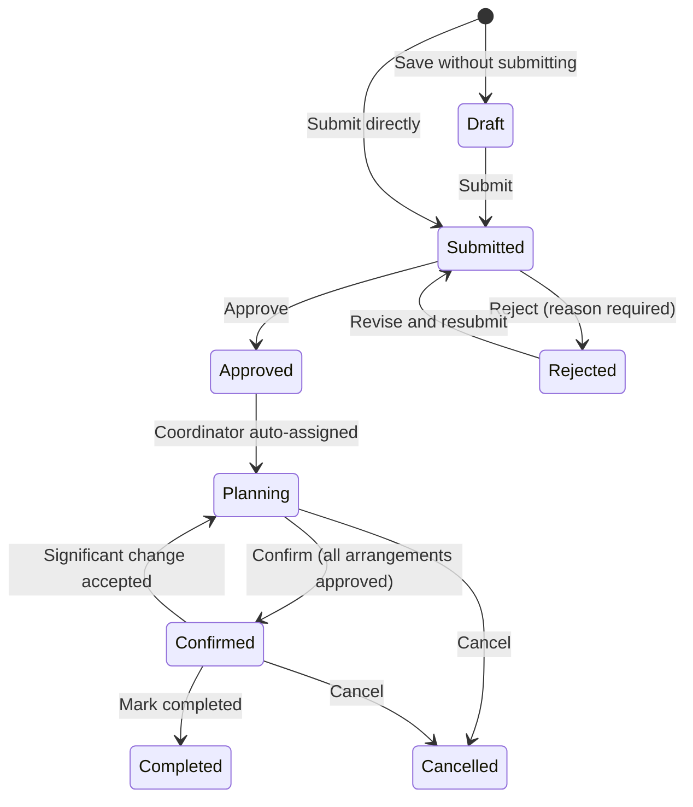
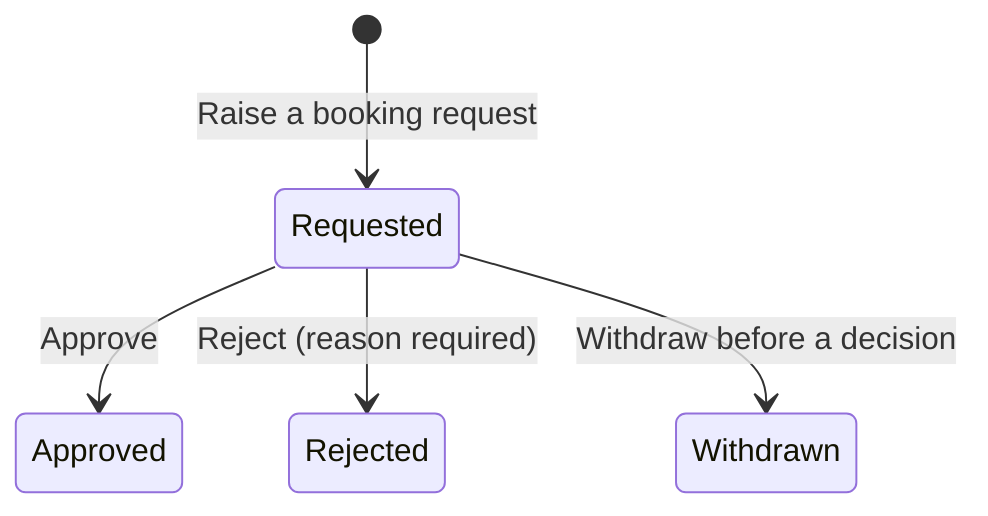
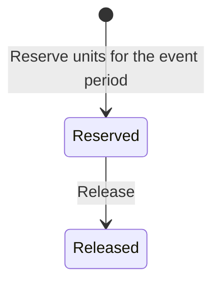
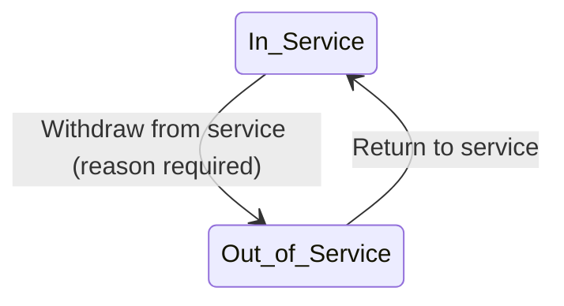
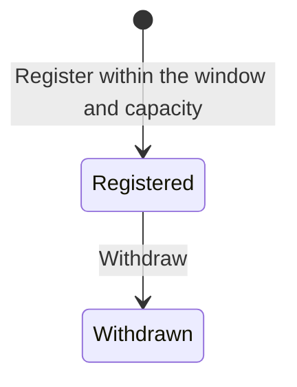

# State model

Every acceptance criterion that changes a status uses a value from these tables. Adding a status or transition means changing this file first, in the same pull request as the story that needs it.

| Version | Date | Change | Reason |
|---|---|---|---|
| 1.0 | 10-09-2026 | Initial model | Pre-sprint preparation |
| 1.1 | 15-09-2026 | Event request: removed Under Clarification (clarification is a flag on Submitted); added Rejected → Submitted; added Confirmed → Planning; Approved → Planning is by system assignment; Confirm requires every recorded arrangement approved; Cancelled is terminal | Customer clarifications Q-01, Q-11 (decision log); team decisions D-13, D-14, D-15, D-16 |
| 1.2 | 16-09-2026 | No change to any status or transition; recorded that the front end mirrors these words | `ui-guidelines.md` v1.1 §9 stops pages typing status strings by hand |
| 1.3 | 08-10-2026 | Venue booking request: dropped the unenforced "(conflict check passes)" qualifier on Approve, with a footnote explaining why | SCRUM-37 review: the qualifier predates any story that defines what a conflict is; approving now matches what the criteria actually say |

The front end holds these words in `frontend/src/app/format.js` (`STATUS`); a change here changes that file in the same pull request.

## Event request

| From | To | Action | Who |
|---|---|---|---|
| — | Draft | Save a new request without submitting | Event Organiser |
| Draft | Submitted | Submit | Event Organiser |
| — | Submitted | Submit a new request directly | Event Organiser |
| Submitted | Approved | Approve | Event Coordinator |
| Submitted | Rejected | Reject (reason required) | Event Coordinator |
| Rejected | Submitted | Revise and resubmit | Event Organiser |
| Approved | Planning | Coordinator auto-assigned by the system | System |
| Planning | Confirmed | Confirm (every recorded arrangement approved) | Event Coordinator |
| Confirmed | Planning | Significant change accepted via change request | Event Coordinator |
| Confirmed | Completed | Mark completed after the event | Event Coordinator |
| Planning / Confirmed | Cancelled | Cancel | Authorised user (SCRUM-65 defines who) |

Flags on a Submitted request, not statuses: **clarification requested** (set by the Event Coordinator, cleared when the Event Organiser responds). Cancelled has no outgoing transition; a new request is submitted instead.

## Venue booking request

| From | To | Action | Who |
|---|---|---|---|
| — | Requested | Raise a booking request | Event Coordinator |
| Requested | Approved | Approve\* | Venue Staff |
| Requested | Rejected | Reject (reason required) | Venue Staff |
| Requested | Withdrawn | Withdraw before a decision | Event Coordinator |

\* "(conflict check passes)" from earlier versions of this table is not enforced: no story's acceptance criteria have ever defined what a conflict is (another Approved booking for the same venue over an overlapping period, most likely) or asked for it to be checked. SCRUM-37 approves unconditionally once the request is still Requested (team decision, 08-10-2026). Add the rule, and the "conflict check passes" qualifier back, in the same pull request as whichever story defines it.

## Equipment reservation

| From | To | Action | Who |
|---|---|---|---|
| — | Reserved | Reserve units for the event period | Technical Support Staff |
| Reserved | Released | Release | Technical Support Staff |

## Equipment unit

| From | To | Action | Who |
|---|---|---|---|
| In Service | Out of Service | Withdraw from service (reason required) | Technical Support Staff |
| Out of Service | In Service | Return to service | Technical Support Staff |

## Registration

| From | To | Action | Who |
|---|---|---|---|
| — | Registered | Register within the window and capacity | Attendee |
| Registered | Withdrawn | Withdraw | Attendee |

