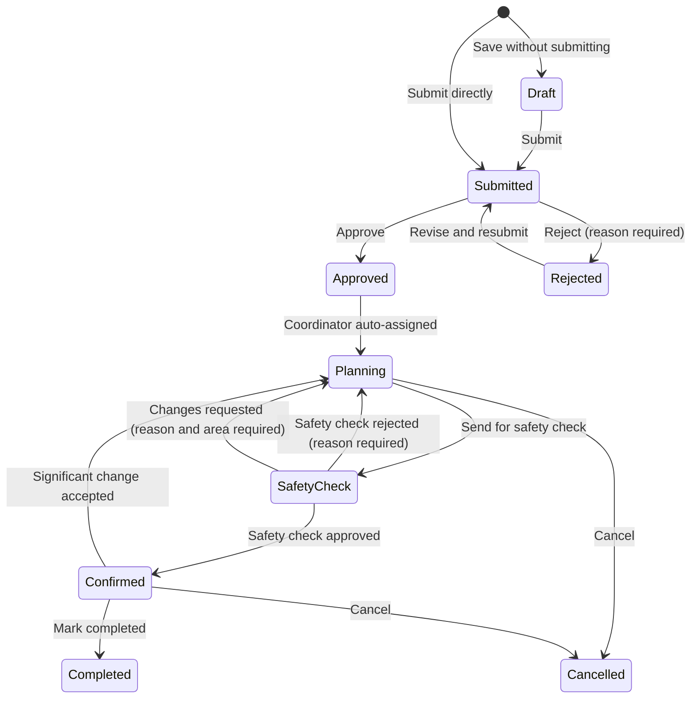
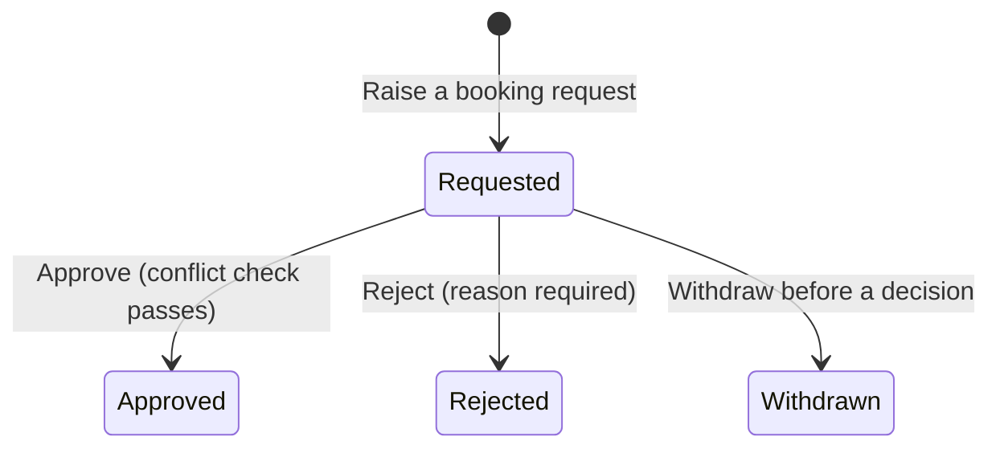
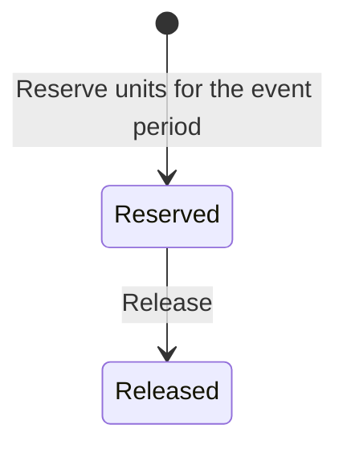
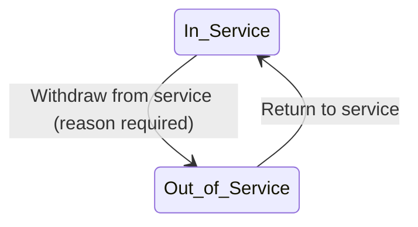
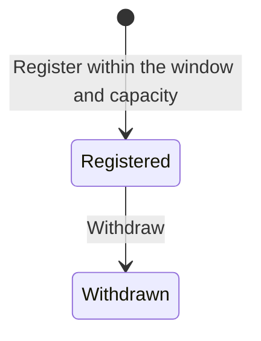

# State model

Every acceptance criterion that changes a status uses a value from these tables. Adding a status or transition means changing this file first, in the same pull request as the story that needs it.

| Version | Date | Change | Reason |
|---|---|---|---|
| 1.0 | 10-09-2026 | Initial model | Pre-sprint preparation |
| 1.1 | 15-09-2026 | Event request: removed Under Clarification (clarification is a flag on Submitted); added Rejected → Submitted; added Confirmed → Planning; Approved → Planning is by system assignment; Confirm requires every recorded arrangement approved; Cancelled is terminal | Customer clarifications Q-01, Q-11 (decision log); team decisions D-13, D-14, D-15, D-16 |
| 1.2 | 16-09-2026 | No change to any status or transition; recorded that the front end mirrors these words | `ui-guidelines.md` v1.1 §9 stops pages typing status strings by hand |
| 1.3 | 08-10-2026 | Venue booking request: dropped the unenforced "(conflict check passes)" qualifier on Approve, with a footnote explaining why | SCRUM-37 review: the qualifier predates any story that defines what a conflict is; approving now matches what the criteria actually say |
| 1.4 | 09-10-2026 | Venue booking request: restored "(conflict check passes)" on Approve, defined the conflict and removed the 1.3 footnote | SCRUM-38 is the story that defines a conflict and enforces it |
| 1.5 | 09-10-2026 | Venue booking request: the conflict is defined on occupied periods — a booking's period widened by the venue's setup and turnaround time — while a block keeps its own period | SCRUM-41 reserves setup and turnaround time around a booking, so two bookings conflict when their occupied periods overlap, and the decision records that blocks themselves are never widened |
| 1.6 | 09-10-2026 | Venue booking request: an extreme recorded duration clamps its occupied period at the edge of Python's date range instead of raising, and no maximum duration is invented | SCRUM-41 review: an accepted setup time of 2000000000 minutes made every read of the venue's bookings fail; reads must keep answering |
| 1.7 | 11-10-2026 | New: Notification, with read as a flag, not a status | SCRUM-58: a notification is created once and never changes status; whether it has been read is a flag on the row, the same pattern as "clarification requested" on an event request |
| 1.8 | 12-10-2026 | Equipment reservation: no status change; recorded that a reservation always belongs to an event and its period is a snapshot of that event's period, complete and valid; defined the committed-peak rule (Reserved only, half-open periods, one window-parameterized calculation shared by SCRUM-49/50/51) | SCRUM-49 AC4 needs an agreed definition of "maximum simultaneously committed units" so the stock guard, the availability check and the reserve check can never become three competing formulas (was 1.7 on the branch; renumbered after SCRUM-58's 1.7 merged first) |
| 1.9 | 13-10-2026 | Event request: new status Safety Check, between Planning and Confirmed; Safety Check → Confirmed (approve) and Safety Check → Planning (reject, reason required) by the Safety Officer. Planning → Safety Check is SCRUM-53's; until it is merged, events enter Safety Check only through the seed data. SCRUM-53 also removes Planning → Confirmed | Week 7 customer change 6; SCRUM-89 (copied from `target/state-model.md` v1.3, this story's slice) |
| 1.10 | 14-10-2026 | Event request: Safety Check → Planning also by Request changes (reason and at least one area required); the Safety changes requested flag on Planning, cleared when the event is sent again | Week 7 customer change 6; SCRUM-90 (copied from `target/state-model.md` v1.3, this story's slice) |
| 1.11 | 14-10-2026 | Event request: Planning → Safety Check is built (sent by the assigned Event Coordinator when every recorded arrangement is approved); Planning → Confirmed (Confirm) is removed, so an event becomes Confirmed only when the Safety Officer approves it | Week 7 customer change 6; SCRUM-53 (copied from `target/state-model.md` v1.3, this story's slice) |
| 1.12 | 14-10-2026 | Equipment reservation: no status change; the committed peak may leave one event's reservations out; SCRUM-50 reports the peak as the units reserved for the period | SCRUM-50 AC3, AC4 and AC6 |

The front end holds these words in `frontend/src/app/format.js` (`STATUS`); a change here changes that file in the same pull request.

## Event request

| From | To | Action | Who |
|---|---|---|---|
| — | Draft | Save a new request without submitting | Event Organiser |
| Draft | Submitted | Submit | Event Organiser |
| — | Submitted | Submit a new request directly | Event Organiser |
| Submitted | Approved | Approve | Event Coordinator |
| Submitted | Rejected | Reject (reason required) | Event Coordinator |
| Rejected | Submitted | Revise and resubmit | Event Organiser |
| Approved | Planning | Coordinator auto-assigned by the system | System |
| Planning | Safety Check | Send for safety check (every recorded arrangement approved) | Assigned Event Coordinator |
| Safety Check | Confirmed | Approve the safety check | Safety Officer |
| Safety Check | Planning | Reject the safety check (reason required) | Safety Officer |
| Safety Check | Planning | Request changes (reason and at least one area required) | Safety Officer |
| Confirmed | Planning | Significant change accepted via change request | Event Coordinator |
| Confirmed | Completed | Mark completed after the event | Event Coordinator |
| Planning / Confirmed | Cancelled | Cancel | Authorised user (SCRUM-65 defines who) |

Flags on a Submitted request, not statuses: **clarification requested** (set by the Event Coordinator, cleared when the Event Organiser responds). Cancelled has no outgoing transition; a new request is submitted instead.

Flags, not statuses (continued): **safety changes requested**, on Planning: set by the Safety Officer's request for changes with its reason and areas (venue arrangements, technical arrangements, or both), and cleared when the event is sent for safety check again (SCRUM-90). It is not stored: it is the latest decision, while that decision is a request for changes and the event has not been sent since it.

Each decision the Safety Officer makes is kept with the event: the decision, its reason where one is required, the areas where changes were requested, an optional note per area, the date and the Safety Officer. An event that returns to Safety Check keeps every earlier decision (SCRUM-89).

## Venue booking request

| From | To | Action | Who |
|---|---|---|---|
| — | Requested | Raise a booking request | Event Coordinator |
| Requested | Approved | Approve (conflict check passes) | Venue Staff |
| Requested | Rejected | Reject (reason required) | Venue Staff |
| Requested | Withdrawn | Withdraw before a decision | Event Coordinator |

A conflict (SCRUM-38, widened by SCRUM-41) is an Approved booking or a block of the same venue whose occupied period overlaps the booking's occupied period. A booking's occupied period is its own period widened by the venue's setup and turnaround time (SCRUM-41 AC1); a block keeps its own recorded period and is never widened. Requested, Rejected and Withdrawn bookings never conflict, periods that only touch at a boundary do not overlap, and a booking never conflicts with itself. A refused approval leaves the booking Requested. Rejecting is never checked.

A recorded duration carries no maximum, so an extreme setup or turnaround time can push an occupied period past the first or last date Python represents. The period then clamps to that edge instead of raising: it stays as wide as the duration asks for, and every read that derives it — the booking list, search, warnings, the clash list and the conflict check — still answers. No maximum duration is invented (occupancy.py, `_shift`).

## Equipment reservation

| From | To | Action | Who |
|---|---|---|---|
| — | Reserved | Reserve units for the event period | Technical Support Staff |
| Reserved | Released | Release | Technical Support Staff |

A reservation always belongs to an event: the link is required, and it survives release. Its period (date, start time, end time) is a **snapshot** of the event's period taken when the reservation is made — the same convention as a venue booking request, which is copied from its event at the moment of raising and is not moved by a later change to the event (models.VenueBookingRequest). Every reservation therefore carries a complete, valid period: a real date, `HH:MM` times, start strictly before end. Event date and times cannot change once an event leaves Draft under today's rules, so a snapshot cannot drift now; **the future story that first makes event timing mutable after a reservation exists owns deciding whether linked reservation periods move with it.** That reconciliation is not part of SCRUM-49.

**What commits stock.** Only a reservation in `Reserved` commits units; `Released` never does, and a past reservation period never does. A requirement that has not become a reservation commits nothing.

**Leaving an event out (SCRUM-50).** The committed peak can leave one event's reservations out, so a check made for an event's own requirement does not count what that event already holds (SCRUM-50 AC6).

**The committed peak (one calculation, three consumers).** For a type and a half-open time window `[window_start, window_end)` — `window_end` omitted meaning unbounded future — the committed peak is the maximum number of units of that type simultaneously held by `Reserved` reservations whose own half-open periods `[start, end)` overlap the window. Periods that only touch at a boundary do not overlap, and where a period ends exactly where another begins the ending is applied first (the same boundary rule as venue occupancy). SCRUM-49's stock-reduction guard asks for the peak over `[now, ∞)`: a total may not fall below it. SCRUM-50's availability check asks for the peak inside a proposed event's period, and SCRUM-51 must ask the same period-scoped question when reserving — neither may count commitments outside their window. `now` is `clock.now_local()`. One function answers all three; there is no second formula.

## Equipment unit

| From | To | Action | Who |
|---|---|---|---|
| In Service | Out of Service | Withdraw from service (reason required) | Technical Support Staff |
| Out of Service | In Service | Return to service | Technical Support Staff |

## Registration

| From | To | Action | Who |
|---|---|---|---|
| — | Registered | Register within the window and capacity | Attendee |
| Registered | Withdrawn | Withdraw | Attendee |

## Notification

A notification has no status and no transition: it is created once, addressed to one account, and never changes afterwards except for one flag.

Flag, not a status: **read** (set when the recipient opens it; cleared never — there is no "mark unread"). The same pattern as "clarification requested" on an event request, above.
