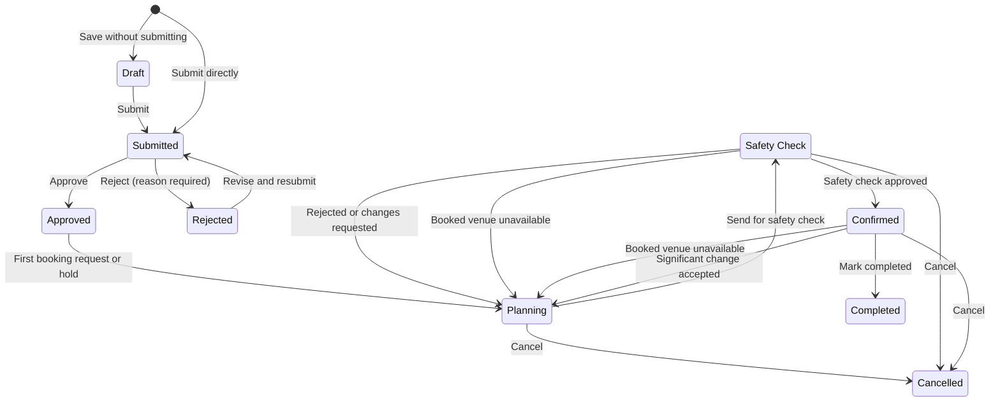
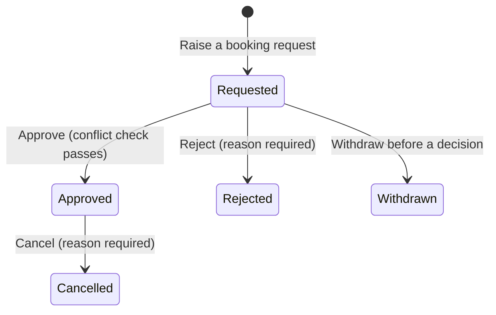
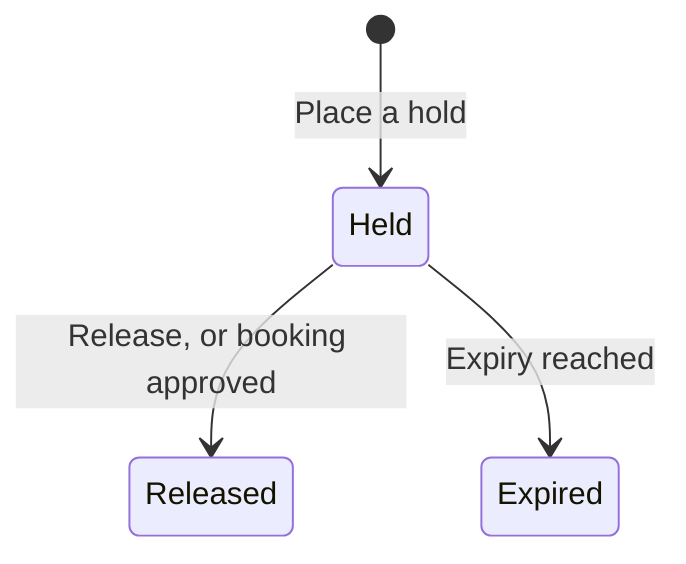
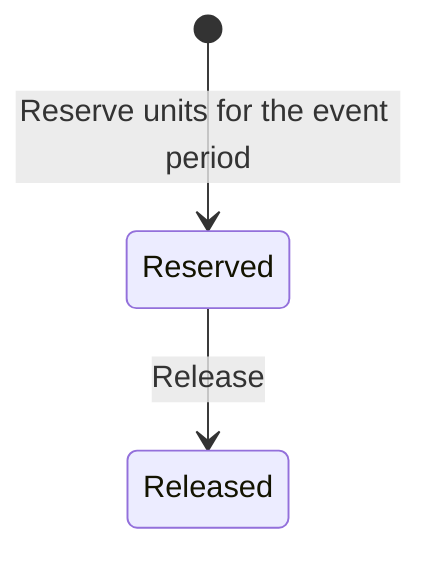
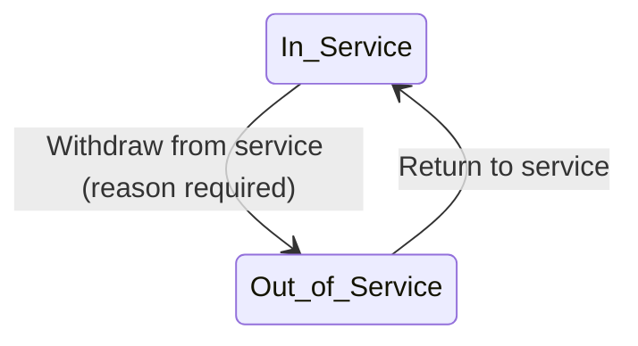
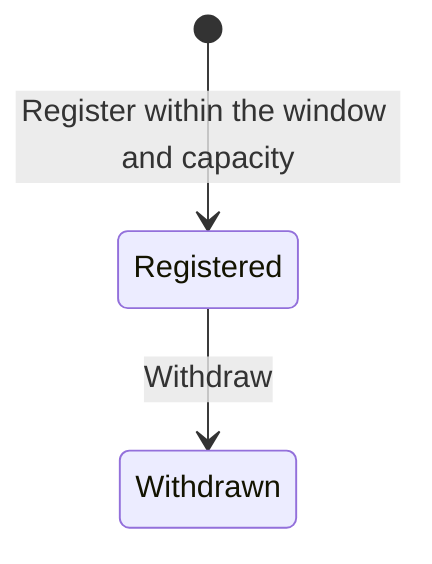

> **Target design after the Week 7 customer changes. Not in force.**
> This is where `docs/design/state-model.md` will be once every Week 7 story is merged. Do not build from this file as a whole.
> Each story copies only its own slice into `docs/design/state-model.md` in its own pull request, and adds that file's version row then, numbered in merge order (the version row below is a placeholder).
> Which slice belongs to which story is in the "Take note" line of the story's Links and notes in the Backlog. Delete this file in the pull request that merges the last slice.

# State model

Every acceptance criterion that changes a status uses a value from these tables. Adding a status or transition means changing this file first, in the same pull request as the story that needs it.

| Version | Date | Change | Reason |
|---|---|---|---|
| 1.0 | 10-09-2026 | Initial model | Pre-sprint preparation |
| 1.1 | 15-09-2026 | Event request: removed Under Clarification (clarification is a flag on Submitted); added Rejected → Submitted; added Confirmed → Planning; Approved → Planning is by system assignment; Confirm requires every recorded arrangement approved; Cancelled is terminal | Customer clarifications Q-01, Q-11 (decision log); team decisions D-13, D-14, D-15, D-16 |
| 1.2 | 16-09-2026 | No change to any status or transition; recorded that the front end mirrors these words | `ui-guidelines.md` v1.1 §9 stops pages typing status strings by hand |
| 1.3 | 02-10-2026 | Event request: assignment moves to submission (unassigned queue, Lead assigns; not a status); Approved → Planning when the first booking request or hold is raised; new status Safety Check between Planning and Confirmed (Planning → Confirmed removed); Safety Check → Planning on safety reject or request changes; Safety Check / Confirmed → Planning when a booked venue becomes unavailable; Safety Check → Cancelled. Venue booking request: Approved → Cancelled; Venue unavailable flag on Approved. New: Venue hold (Held, Released, Expired) | Week 7 customer changes 2–6; SCRUM-53, SCRUM-82 to SCRUM-90 |

The front end holds these words in `frontend/src/app/format.js` (`STATUS`); a change here changes that file in the same pull request. v1.3 adds Safety Check, Cancelled (booking), Held, Released and Expired.

## Event request

| From | To | Action | Who |
|---|---|---|---|
| — | Draft | Save a new request without submitting | Event Organiser |
| Draft | Submitted | Submit | Event Organiser |
| — | Submitted | Submit a new request directly | Event Organiser |
| Submitted | Approved | Approve | Assigned Event Coordinator |
| Submitted | Rejected | Reject (reason required) | Assigned Event Coordinator |
| Rejected | Submitted | Revise and resubmit (keeps its assigned coordinator) | Event Organiser |
| Approved | Planning | First venue booking request or hold raised for the event | System, on the assigned coordinator's action |
| Planning | Safety Check | Send for safety check (every recorded arrangement approved) | Assigned Event Coordinator |
| Safety Check | Confirmed | Approve the safety check | Safety Officer |
| Safety Check | Planning | Reject the safety check (reason required) | Safety Officer |
| Safety Check | Planning | Request changes (reason and area required) | Safety Officer |
| Safety Check / Confirmed | Planning | An approved venue booking is marked Venue unavailable | System |
| Confirmed | Planning | Significant change accepted via change request | Assigned Event Coordinator |
| Confirmed | Completed | Mark completed after the event | Assigned Event Coordinator |
| Planning / Safety Check / Confirmed | Cancelled | Cancel | Authorised user (SCRUM-65 defines who) |

Assignment is not a status. A Submitted request with no assigned coordinator is in the **unassigned queue**; the Event Coordinator Lead assigns it, and the status stays Submitted (SCRUM-86). Reassignment never changes the status (SCRUM-44).

Flags, not statuses:
- **Clarification requested**, on Submitted: set by the assigned Event Coordinator, cleared when the Event Organiser responds.
- **Safety changes requested**, on Planning: set by the Safety Officer with the reason and areas (venue arrangements, technical arrangements, or both), cleared when the event is sent for safety check again (SCRUM-90).

Cancelled has no outgoing transition; a new request is submitted instead.

## Venue booking request

| From | To | Action | Who |
|---|---|---|---|
| — | Requested | Raise a booking request | Assigned Event Coordinator |
| Requested | Approved | Approve (no overlap with an approved booking, a block or another event's Held hold) | Venue Staff |
| Requested | Rejected | Reject (reason required) | Venue Staff |
| Requested | Withdrawn | Withdraw before a decision | Assigned Event Coordinator |
| Approved | Cancelled | Cancel (reason required; event Approved or Planning) | Assigned Event Coordinator |

An event may have several booking requests, each with its own status; a transition on one never changes another (SCRUM-83).

Flag on Approved, not a status: **Venue unavailable**, set by the system when a block overlaps the booking's occupied period; cleared when the block no longer overlaps or the booking is cancelled (SCRUM-82).

## Venue hold

| From | To | Action | Who |
|---|---|---|---|
| — | Held | Place a hold (expiry required, in the future and before the event's start) | Assigned Event Coordinator |
| Held | Released | Release before expiry | Assigned Event Coordinator |
| Held | Released | A booking request for the same venue and event is approved | System |
| Held | Expired | Expiry date and time reached | System |

Only a Held hold makes the venue unavailable. A hold is never a booking and never counts as an approved arrangement (SCRUM-84, SCRUM-85).

## Equipment reservation

| From | To | Action | Who |
|---|---|---|---|
| — | Reserved | Reserve units for the event period | Technical Support Staff |
| Reserved | Released | Release | Technical Support Staff |

A reservation always belongs to an event: the link is required, and it survives release. Its period (date, start time, end time) is a **snapshot** of the event's period taken when the reservation is made — the same convention as a venue booking request, which is copied from its event at the moment of raising and is not moved by a later change to the event (models.VenueBookingRequest). Every reservation therefore carries a complete, valid period: a real date, `HH:MM` times, start strictly before end. Event date and times cannot change once an event leaves Draft under today's rules, so a snapshot cannot drift now; **the future story that first makes event timing mutable after a reservation exists owns deciding whether linked reservation periods move with it.** That reconciliation is not part of SCRUM-49.

**What commits stock.** Only a reservation in `Reserved` commits units; `Released` never does, and a past reservation period never does. A requirement that has not become a reservation commits nothing.

**The committed peak (one calculation, three consumers).** For a type and a half-open time window `[window_start, window_end)` — `window_end` omitted meaning unbounded future — the committed peak is the maximum number of units of that type simultaneously held by `Reserved` reservations whose own half-open periods `[start, end)` overlap the window. Periods that only touch at a boundary do not overlap, and where a period ends exactly where another begins the ending is applied first (the same boundary rule as venue occupancy). SCRUM-49's stock-reduction guard asks for the peak over `[now, ∞)`: a total may not fall below it. SCRUM-50's availability check asks for the peak inside a proposed event's period, and SCRUM-51 must ask the same period-scoped question when reserving — neither may count commitments outside their window. `now` is `clock.now_local()`. One function answers all three; there is no second formula.

## Equipment unit

| From | To | Action | Who |
|---|---|---|---|
| In Service | Out of Service | Withdraw from service (reason required) | Technical Support Staff |
| Out of Service | In Service | Return to service | Technical Support Staff |

## Registration

| From | To | Action | Who |
|---|---|---|---|
| — | Registered | Register within the window and capacity | Attendee |
| Registered | Withdrawn | Withdraw | Attendee |

